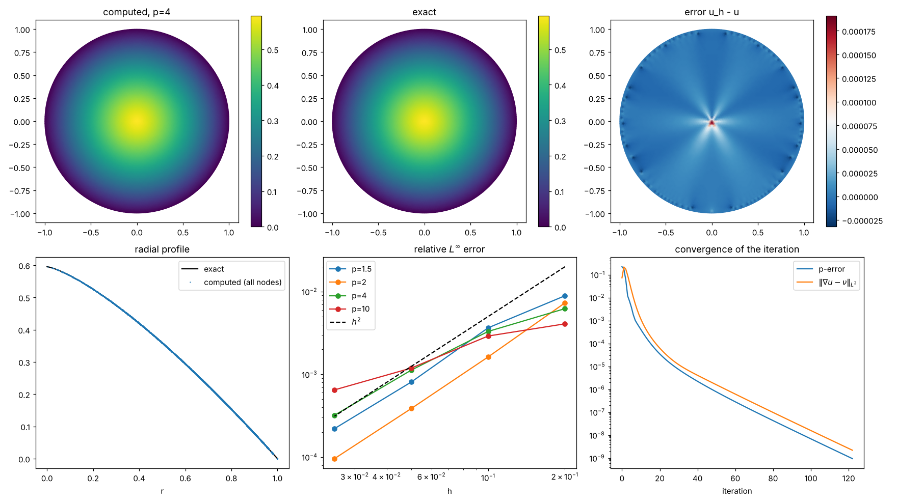
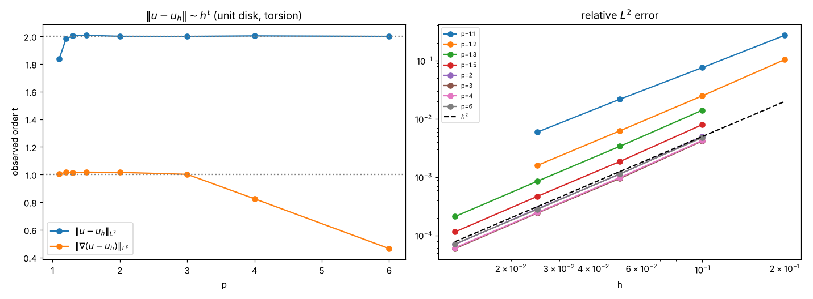
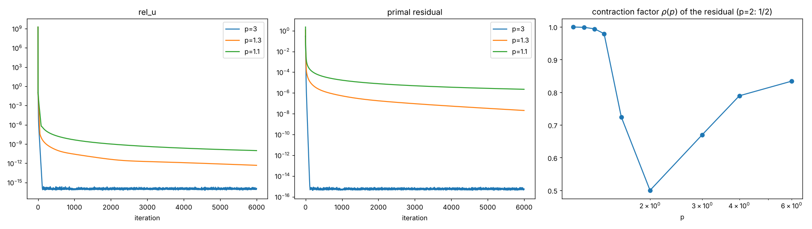

# pxlaplace — p(x)-Laplacian solver on general 2D domains

[](https://colab.research.google.com/github/jfbonder/pxlaplace/blob/main/notebooks/pxlaplace_colab.ipynb)

Python implementation of the **decomposition–coordination method** for the Dirichlet problem

$$
-\mathrm{div}\!\big(|\nabla u|^{p(x)-2}\nabla u\big)=f \ \text{ in }\Omega\subset\mathbb R^2,\qquad u=g\ \text{ on }\partial\Omega ,
$$

with piecewise-linear (P1) finite elements. It is a vectorised port of the MatLab code that accompanies

> A. Aragón, J. Fernández Bonder, D. Rubio, *Effective numerical computation of p(x)-Laplace equations in 2D* (paper in [`paper/`](paper)). A rewritten, updated version of the paper (new implementation and experiments) is in [`paper/v2/`](paper/v2).

The original code worked on rectangles only; here **the solver is independent of the domain**: it only needs a triangulation.

## Contents

```
pxlaplace/            the package (mesh.py, fem.py, nonlinear.py, solver.py)
notebooks/            pxlaplace_colab.ipynb  -> self-contained notebook, opens in Google Colab
examples/             paper_examples.py (Examples 1-5 of the paper), torsion_disk.py (disk vs explicit solution)
tests/                pytest suite
paper/                the paper (.tex and .pdf)
docs/                 figures
```

## The method

With $r>0$ (the paper uses $r=1$), starting from $\nu_0,\eta_1$ (zero by default), iterate:

1. **Linear PDE** (same matrix every step): $\ -r\Delta u_n=f+\mathrm{div}(\eta_n-r\nu_{n-1})$, $u_n=g$ on $\partial\Omega$.
2. **Pointwise algebraic equation**: $\ |\nu_n|^{p-2}\nu_n+r\nu_n=\eta_n+r\nabla u_n$. Writing $t=|\nu_n|$ this is the scalar equation $t^{p-1}+rt=r|\eta_n/r+\nabla u_n|$, which has a unique root; $\nu_n$ has the direction of $\eta_n+r\nabla u_n$.
3. **Multiplier update**: $\ \eta_{n+1}=\eta_n+r(\nabla u_n-\nu_n)$.

Implementation notes (what changed with respect to the MatLab code):

* the stiffness matrix is assembled, restricted to the interior nodes and **LU-factorised once**; every iteration is only a back-substitution;
* gradients and the weak divergence $\int q\cdot\nabla\phi_i$ are sparse mat-vecs, and the scalar equation is solved by a **vectorised bisection** over all elements at once (no Python loops);
* $\nu=w\,t/|w|$ is used instead of $w/(t^{p-2}+1)$, so there is no $0^{p-2}$ singularity for $p<2$;
* Dirichlet conditions are imposed by elimination (symmetric system), not by overwriting matrix rows;
* `p` is sampled at the element barycentres (as in the paper); `f` uses the barycentre rule (`f_degree=1`, as in the MatLab code) or a degree-2 rule (`f_degree=2`).

Typical cost: Example 1 of the paper (p = 20, 100×100 grid) takes ~15 s here for 560 iterations at `tol=1e-6` (the paper reports ~75 s for the MatLab version).

## Installation

```bash
git clone https://github.com/jfbonder/pxlaplace.git
cd pxlaplace
pip install -e .                 # numpy, scipy, matplotlib
pip install -e ".[meshing]"      # optional: `triangle` (polygons with holes) and `meshio` (Gmsh, VTK...)
```

Or just open the notebook in Colab (button above): it embeds the whole package, no installation needed.

## Usage

```python
import numpy as np
from pxlaplace import rectangle_mesh, PxLaplaceSolver, P1Space

# Example 3 of the paper: variable exponent, exact solution known
p  = lambda x, y: 1 + 1/((x + y)/2 + 2)
ex = lambda x, y: np.sqrt(2)*np.e**2*(np.exp(0.5*(x + y)) - 1)

mesh   = rectangle_mesh(100, 100, -1, 1, -1, 1)       # 100x100 cells, 2 triangles each
solver = PxLaplaceSolver(mesh, p=p, f=0.0, g=ex)      # set-up + factorisation (once)
res    = solver.solve(tol=1e-7)                       # iterate

print(res.iterations, res.converged)
mesh.plot(res.u)                                      # res.u: nodal values
```

`p`, `f`, `g` can be a number, an array, or a function `fun(x, y)` (NumPy-vectorised; plain scalar functions also work, more slowly).
`g` is evaluated at the Dirichlet nodes. One-shot form: `solve(mesh, p, f, g, tol=...)`.

### Solver options

| argument | meaning |
|---|---|
| `PxLaplaceSolver(mesh, p, f, g, r=1.0, f_degree=1)` | `r`: augmented-Lagrangian parameter (paper: 1); `f_degree`: quadrature for the load vector |
| `.solve(tol=1e-5, max_iter=2000, stop="rel_u", init="zero")` | |
| `stop="rel_u"` | stop when $\lVert u_n-u_{n-1}\rVert_2/\lVert u_{n-1}\rVert_2<$ `tol` (criterion of the MatLab code) |
| `stop="p_error"` | stop when $J_p(u_n-u_{n-1})^{1/\max p}<$ `tol`, $J_p(w)=\int|w|^p$ (criterion described in the paper). Preferable when $u$ is very small in size (e.g. Example 2) |
| `init="zero" / "random"` | $\nu=\eta=0$ (recommended) or $0.15\cdot$rand as in the MatLab code |
| `callback(it, u, history)`, `verbose=True` | monitoring |

The returned `SolveResult` has `u`, `nu`, `eta` (element-wise vector fields), `iterations`, `converged`, `time_setup`, `time_iter` and `history` with per-iteration arrays `rel_u`, `p_error`, `residual` ($\lVert\nabla u-\nu\rVert_{L^2}$) and `energy`.

Error helpers in `P1Space(mesh)`: `norm_inf`, `norm_L2`, `norm_Lp(w, p)`, `modular(w, p)`, `gradient(u)`; and, for the **true** finite-element errors (degree-4 quadrature), `l2_error(uh, u_exact)` and `grad_error_Lp(uh, grad_exact, p)`. Note that `norm_L2`/`norm_Lp` applied to nodal differences measure $\lVert I_hu-u_h\rVert$, which is *not* the FE error (supercloseness makes it much smaller).

### Meshes / general domains

Any triangulation works: `Mesh(vertices, triangles, dirichlet)` with 0-based NumPy arrays.

| helper | domain |
|---|---|
| `rectangle_mesh(n, m, xmin, xmax, ymin, ymax)` | rectangles |
| `polygon_mesh(outer, holes=[...], max_area=...)` | polygons with polygonal holes (quality Delaunay, needs `triangle`) |
| `sdf_mesh(sdf, bbox, h0)`, `disk_mesh(h0)` | any domain given by a signed-distance function (pure NumPy/SciPy, DistMesh-style) |
| `from_meshio("domain.msh")` | Gmsh / VTK / ... (boundary nodes detected automatically) |
| `from_txt(vertex_file, elem_file, dirichlet_file)` | the three text files of the MatLab code (1-based) |

```python
from pxlaplace import polygon_mesh
L    = [(0,0),(2,0),(2,1),(1,1),(1,2),(0,2)]
mesh = polygon_mesh(L, max_area=1e-3)
res  = PxLaplaceSolver(mesh, lambda x, y: 1.5 + x/2, f=1.0, g=0.0).solve(tol=1e-7)
```

More: the notebook [`notebooks/pxlaplace_colab.ipynb`](notebooks/pxlaplace_colab.ipynb) (L-shape, annulus, union of discs, disk with exact solution, convergence diagnostics).

## Reproducing the paper

```bash
python examples/paper_examples.py --plot        # Examples 1-5, prints errors, writes paper_examples.png
```


100×100 grid (Example 5: 200×100), P1 elements:

| Example | iterations | sup error at nodes (abs / rel) | true relative $L^2$ error | paper (sup) |
|---|---|---|---|---|
| 1: $p=20$, $u=(x^2+y^2)^{\frac{p-2}{2p-2}}$ | 560 | 1.2e-3 / 8.9e-4 | 3.0e-4 | 2e-3 |
| 2: torsion $p=1.1$, exact solution | 522 | 1.4e-5 / **16%** (see note 3) | 5.0e-2 | 2e-4 |
| 3: $p(x,y)=1+(\frac{x+y}{2}+2)^{-1}$ | 87 | 1.9e-5 / 1.1e-6 | 2.4e-5 | 1.5e-5 |
| 4: torsion, $p=1.15,\,4,\,50$ | 378, 40, 132 | – | – | – |
| 5: discontinuous $p\in\{1.2,4\}$ | 43 | – | – | – |

(Tolerances: 1e-6 for Examples 1, 4, 5; 1e-7 for Example 3; `stop="p_error"`, 1e-8 for Example 2.) "True" $L^2$ errors are computed
with a degree-4 quadrature rule on each triangle (`P1Space.l2_error`), not from nodal differences (see the note on error measures below).
The Example 1-2 errors are dominated by the iteration (stopping) error as much as by the discretisation; Example 2 is a very small solution
($\max u\approx 9\times10^{-5}$) and the absolute criterion `p_error` is not adequate for it: after 4000 iterations the error was still moving (1.3%).

## p-torsion problem on the unit disk (comparison with the explicit solution)

For $-\Delta_p u=1$ in $B_1$, $u=0$ on $\partial B_1$ the solution is explicit,
$u(x,y)=c_p\,(1-r^{p/(p-1)})$, $c_p=\frac{p-1}{p}\,2^{-1/(p-1)}$, $r=\sqrt{x^2+y^2}$.
`examples/torsion_disk.py` meshes the disk (`disk_mesh(h)`), solves with the method and compares with this formula
for several exponents under mesh refinement:

```bash
python examples/torsion_disk.py --plot                 # p = 1.5, 2, 4, 10; figure for p = 4
python examples/torsion_disk.py --p 3 --ps 1.2 3 --h 0.1 0.05 0.025 --plot
```



Errors ($h$ = target edge length, `stop="p_error"`, tol 1e-9); `sup` is the maximum over the nodes of $|u-u_h|$ and $L^2$ is the true
$L^2(B_1)$ error computed by quadrature:

| p | h=0.2 | h=0.1 | h=0.05 | h=0.025 | order (last step) |
|---|---|---|---|---|---|
| 1.5, $L^2$ | 3.5e-3 | 7.9e-4 | 1.8e-4 | 4.6e-5 | 2.0 |
| 1.5, sup (nodes) | 7.4e-4 | 3.0e-4 | 6.7e-5 | 1.8e-5 | 1.9 |
| 2, $L^2$ | 5.4e-3 | 1.3e-3 | 2.9e-4 | 7.4e-5 | 2.0 |
| 2, sup (nodes) | 1.8e-3 | 4.1e-4 | 9.7e-5 | 2.4e-5 | 2.0 |
| 4, $L^2$ | 8.7e-3 | 2.2e-3 | 5.0e-4 | 1.2e-4 | 2.0 |
| 4, sup (nodes) | 3.7e-3 | 2.0e-3 | 6.7e-4 | 1.9e-4 | 1.8 |
| 10, $L^2$ | 1.4e-2 | 3.7e-3 | 9.3e-4 | 2.3e-4 | 2.0 |
| 10, sup (nodes) | 3.4e-3 | 2.4e-3 | 9.9e-4 | 5.4e-4 | 0.9 |

The error is concentrated at the origin, where $u$ is only $C^{1,\alpha}$ for $p\neq2$,
so the sup order at the nodes can be below 2 for large $p$; the true $L^2$ order is about 2 for all $p$ tested. The $p=2$ row recovers the standard P1 rate.

## Order of convergence in h and behaviour as p -> 1

`examples/convergence_order.py` solves the p-torsion problem on the unit disk for several p on a sequence of meshes and fits
$\lVert u-u_h\rVert\sim h^t$ (least squares over the 3 finest meshes). Raw data: [`results/convergence_order_torsion_disk.csv`](results/convergence_order_torsion_disk.csv).

```bash
python examples/convergence_order.py --plot --jobs 2
python examples/convergence_order.py --ps 1.05 1.1 1.15 --h 0.1 0.05 0.025 0.0125 --tol 1e-9 --max-iter 6000 --jobs 2   # slow
```



**Which error?** Differences of nodal values, $\lVert I_hu-u_h\rVert$, are *not* the finite-element error: P1 is superclose at the nodes
and these differences converge faster than $h^2$ (they gave spurious orders 2.1-2.5 in an earlier version of this README). The orders below use the
true errors, computed with quadrature (`fem.l2_error`, `fem.grad_error_Lp`); the gradient error is measured in $L^p$.

| p | 1.1 | 1.2 | 1.3 | 1.5 | 2 | 3 | 4 | 6 |
|---|---|---|---|---|---|---|---|---|
| $t$ in $L^2$ | 1.84 (*) | 1.98 (*) | 2.00 | 2.01 | 2.00 | 2.00 | 2.00 | 2.00 |
| $t$ in $\lVert\nabla(u-u_h)\rVert_{L^p}$ | 1.01 | 1.02 | 1.02 | 1.02 | 1.02 | 1.00 | 0.82 | 0.46 |

(*) the iteration did not reach the tolerance (`rel_u < 1e-9`, 6000 iterations) on the finest meshes: the flag is `False` in the CSV, so these two values are
indicative only. For p ≥ 1.3 the $L^2$ order is 2, as for the Poisson problem; the gradient order is about 1 up to p = 3 and degrades for large p, where $u$ has little
regularity at the origin ($u\in C^{1,1/(p-1)}$ is not even $C^2$; note $u\sim 1-r^{p/(p-1)}$).
What degrades as p → 1 is the constant (a boundary layer of width ~ p-1 must be resolved, so $h\ll p-1$ is needed) and the speed of the iteration.
`disk_mesh` produces slightly irregular meshes, so orders between consecutive meshes fluctuate.

`examples/p_to_1_iteration.py` studies the iteration itself ($-\Delta_p u=2$ on the disk, h = 0.05): the contraction factor $\rho(p)$ of the residual
$\lVert\nabla u_n-\nu_n\rVert$ is exactly 1/2 at p=2 (the iteration is a linear fixed-point map there; it is the optimum over the values of p),
about 0.5-0.8 for 1.8 <= p <= 6, and then grows to 0.92 (p=1.5), 0.994 (p=1.3) and 0.9995 (p=1.1, 1.05).
Iterations to `rel_u < 1e-8`: 26 (p=2.5), 28 (1.8), 35 (1.6), 40 (1.5), 48 (1.4), 89 (1.3), 200 (1.2), 680 (1.1), 2113 (1.05).
The parameter r helps only partially (for p=1.1, r=3 needs about half the iterations of r=1).



## Variable exponent p(x): convergence with explicit solutions

`examples/variable_p_convergence.py` (needs `sympy` for the first case; raw output in [`results/variable_p_convergence.txt`](results/variable_p_convergence.txt)):

```bash
python examples/variable_p_convergence.py smooth          # manufactured solution, p = 2 + 0.8x (crosses p = 2)
python examples/variable_p_convergence.py radial --prad jump   # torsion with p = 1.5 (r<0.5), 3 (r>0.5): exact solution
python examples/variable_p_convergence.py radial --prad lin    # torsion with p = 1.5 + 1.5 r
python examples/variable_p_convergence.py example3        # Example 3 of the paper on refined squares
```

For radial torsion, $u'(r)=-(r/2)^{1/(p(r)-1)}$, so $u(r)=\int_r^1 (s/2)^{1/(p(s)-1)}ds$ is exact even when $p$ jumps.
True relative $L^2$ errors (quadrature) and sup errors at the nodes, tolerance `rel_u` 1e-10; order $t$ in $\lVert u-u_h\rVert\sim h^t$ from the 3 finest meshes:

| case | $t$ in $L^2$ | $t$ in sup (nodes) |
|---|---|---|
| smooth $p=2+0.8x$ | 2.04 | 1.72 (noisy) |
| radial, $p=1.5+1.5r$ | 2.00 | 2.03 |
| Example 3 (squares) | 2.00 | 2.00 |
| radial, **discontinuous** $p$ | 1.49 (orders between consecutive meshes: 2.5, 0.6, 1.9, 1.1) | 0.90 |

* For smooth $p(x)$ the method keeps the optimal P1 order 2 in $L^2$, also when $p$ crosses 2.
* In Example 3 the error stagnation seen with `tol=1e-5…1e-7` is the stopping tolerance: with `tol=1e-10` the order is 2
  (true relative $L^2$ error 9.0e-6 and nodal sup error 9.5e-8 for 160x160 cells; the nodal differences are much smaller than the true error because of supercloseness).
* With a **discontinuous** exponent whose jump is not aligned with the mesh, the order drops (about 1.5 in $L^2$, 0.9 at the nodes) and is erratic.
  Sampling $p$ at the barycentre contributes: `examples/p_sampling_diagnostic.py` compares barycentric, arithmetic (8x8 sub-points) and harmonic averages of $p$ per triangle.
  Sub-triangle averaging reduces the true $L^2$ error by a factor 1.5-2.5 at the same $h$ (e.g. 5.7e-4 vs 7.9e-4 at h=0.0125) and the order
  at the nodes is similar (0.96-0.97); the order stays limited by the unresolved interface.

## Tests

```bash
pip install -e ".[test]"
pytest -q
```

Checks stiffness/load assembly, the scalar equation (including $p\to1^+$, $p=50$, tiny and huge right-hand sides), $p=2$ against Poisson's exact solution, Example 3, the torsion problem on a disk (exact solution) with an SDF mesh, a polygon with a hole (maximum principle), and independence of the limit from the initialisation.

## Notes on the paper vs. the MatLab code

Found while porting; none affects the algorithm, but you may want to fix them in the text:

1. **Notation.** In the MatLab code `lambda` is the multiplier $\eta$ and `eta` is $\nu$.
2. **Sign in §3.2.** The text defines `h(k)=∫(η−ν)·∇φ_k` and solves `A u = h + f`. The code (and the weak form of eq. (2.2)) use $\int(\nu-\eta)\cdot\nabla\phi_k$, i.e. $b=f+\int(\nu-\eta)\cdot\nabla\phi$.
3. **Example 2.** For $p=1.1$ the exact solution has maximum $c_p\approx 9\times10^{-5}$. With the reported setting (100x100 grid, `p_error` < 1e-8) we get a sup error of 1.4e-5, i.e. 16% of the maximum, and the iteration is still moving (1.3% after 4000 iterations): the error is mostly iteration error. The absolute `p_error` criterion is not adequate for such small solutions; use a relative criterion and many more iterations. Worth double-checking the reported values.
4. **Stopping criterion.** The text describes the $p$-error ($J_p(\Delta u)^{1/\max p}$, which is not a norm and is absolute); the MatLab `solver.m` uses the relative Euclidean change of $u$ with tolerance 1e-5. Both are available here (`stop=`). With `rel_u`, tolerance 1e-5 is not tight enough for Example 3 (error ≈ 1e-3 vs 1.9e-5 at 1e-7); neither criterion is adequate for p close to 1 or for tiny solutions, where the iteration converges slowly (see $\rho(p)$ above).
5. **Example 4.** The caption says $p=1.15$ but the file is named `torsion_p1_5`.
6. `solver.m` re-factorises the matrix at every iteration (`AA\b`), which is where most of the MatLab time goes; here it is factorised once.

## Citation

If you use this code, please cite the paper above.

## License

MIT — see [`LICENSE`](LICENSE).
