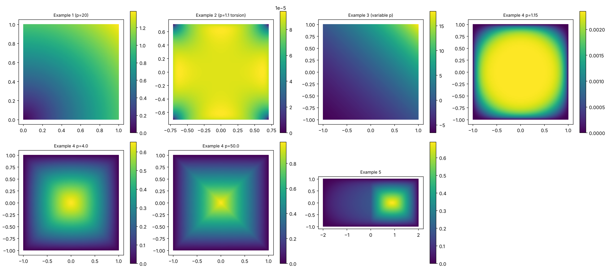

# pxlaplace — p(x)-Laplacian solver on general 2D domains

[](https://colab.research.google.com/github/jfbonder/pxlaplace/blob/main/notebooks/pxlaplace_colab.ipynb)

Python implementation of the **decomposition–coordination method** for the Dirichlet problem

$$
-\operatorname{div}\!\big(|\nabla u|^{p(x)-2}\nabla u\big)=f \ \text{ in }\Omega\subset\mathbb R^2,\qquad u=g\ \text{ on }\partial\Omega ,
$$

with piecewise-linear (P1) finite elements. It is a vectorised port of the MatLab code that accompanies

> A. Aragón, J. Fernández Bonder, D. Rubio, *Effective numerical computation of p(x)-Laplace equations in 2D* (paper in [`paper/`](paper)).

The original code worked on rectangles only; here **the solver is independent of the domain**: it only needs a triangulation.

## Contents

```
pxlaplace/            the package (mesh.py, fem.py, nonlinear.py, solver.py)
notebooks/            pxlaplace_colab.ipynb  -> self-contained notebook, opens in Google Colab
examples/             paper_examples.py      -> Examples 1-5 of the paper
tests/                pytest suite
paper/                the paper (.tex and .pdf)
docs/                 figures
```

## The method

With $r>0$ (the paper uses $r=1$), starting from $\nu_0,\eta_1$ (zero by default), iterate:

1. **Linear PDE** (same matrix every step): $\ -r\Delta u_n=f+\operatorname{div}(\eta_n-r\nu_{n-1})$, $u_n=g$ on $\partial\Omega$.
2. **Pointwise algebraic equation**: $\ |\nu_n|^{p-2}\nu_n+r\nu_n=\eta_n+r\nabla u_n$. Writing $t=|\nu_n|$ this is the scalar equation $t^{p-1}+rt=r|\eta_n/r+\nabla u_n|$, which has a unique root; $\nu_n$ has the direction of $\eta_n+r\nabla u_n$.
3. **Multiplier update**: $\ \eta_{n+1}=\eta_n+r(\nabla u_n-\nu_n)$.

Implementation notes (what changed with respect to the MatLab code):

* the stiffness matrix is assembled, restricted to the interior nodes and **LU-factorised once**; every iteration is only a back-substitution;
* gradients and the weak divergence $\int q\cdot\nabla\phi_i$ are sparse mat-vecs, and the scalar equation is solved by a **vectorised bisection** over all elements at once (no Python loops);
* $\nu=w\,t/|w|$ is used instead of $w/(t^{p-2}+1)$, so there is no $0^{p-2}$ singularity for $p<2$;
* Dirichlet conditions are imposed by elimination (symmetric system), not by overwriting matrix rows;
* `p` is sampled at the element barycentres (as in the paper); `f` uses the barycentre rule (`f_degree=1`, as in the MatLab code) or a degree-2 rule (`f_degree=2`).

Typical cost: Example 1 of the paper (p = 20, 100×100 grid) takes ~15 s here for 560 iterations at `tol=1e-6` (the paper reports ~75 s for the MatLab version).

## Installation

```bash
git clone https://github.com/jfbonder/pxlaplace.git
cd pxlaplace
pip install -e .                 # numpy, scipy, matplotlib
pip install -e ".[meshing]"      # optional: `triangle` (polygons with holes) and `meshio` (Gmsh, VTK...)
```

Or just open the notebook in Colab (button above): it embeds the whole package, no installation needed.

## Usage

```python
import numpy as np
from pxlaplace import rectangle_mesh, PxLaplaceSolver, P1Space

# Example 3 of the paper: variable exponent, exact solution known
p  = lambda x, y: 1 + 1/((x + y)/2 + 2)
ex = lambda x, y: np.sqrt(2)*np.e**2*(np.exp(0.5*(x + y)) - 1)

mesh   = rectangle_mesh(100, 100, -1, 1, -1, 1)       # 100x100 cells, 2 triangles each
solver = PxLaplaceSolver(mesh, p=p, f=0.0, g=ex)      # set-up + factorisation (once)
res    = solver.solve(tol=1e-7)                       # iterate

print(res.iterations, res.converged)
mesh.plot(res.u)                                      # res.u: nodal values
```

`p`, `f`, `g` can be a number, an array, or a function `fun(x, y)` (NumPy-vectorised; plain scalar functions also work, more slowly).
`g` is evaluated at the Dirichlet nodes. One-shot form: `solve(mesh, p, f, g, tol=...)`.

### Solver options

| argument | meaning |
|---|---|
| `PxLaplaceSolver(mesh, p, f, g, r=1.0, f_degree=1)` | `r`: augmented-Lagrangian parameter (paper: 1); `f_degree`: quadrature for the load vector |
| `.solve(tol=1e-5, max_iter=2000, stop="rel_u", init="zero")` | |
| `stop="rel_u"` | stop when $\lVert u_n-u_{n-1}\rVert_2/\lVert u_{n-1}\rVert_2<$ `tol` (criterion of the MatLab code) |
| `stop="p_error"` | stop when $J_p(u_n-u_{n-1})^{1/\max p}<$ `tol`, $J_p(w)=\int|w|^p$ (criterion described in the paper). Preferable when $u$ is very small in size (e.g. Example 2) |
| `init="zero" / "random"` | $\nu=\eta=0$ (recommended) or $0.15\cdot$rand as in the MatLab code |
| `callback(it, u, history)`, `verbose=True` | monitoring |

The returned `SolveResult` has `u`, `nu`, `eta` (element-wise vector fields), `iterations`, `converged`, `time_setup`, `time_iter` and `history` with per-iteration arrays `rel_u`, `p_error`, `residual` ($\lVert\nabla u-\nu\rVert_{L^2}$) and `energy`.

Error helpers in `P1Space(mesh)`: `norm_inf`, `norm_L2`, `norm_Lp(w, p)`, `modular(w, p)`, `gradient(u)`.

### Meshes / general domains

Any triangulation works: `Mesh(vertices, triangles, dirichlet)` with 0-based NumPy arrays.

| helper | domain |
|---|---|
| `rectangle_mesh(n, m, xmin, xmax, ymin, ymax)` | rectangles |
| `polygon_mesh(outer, holes=[...], max_area=...)` | polygons with polygonal holes (quality Delaunay, needs `triangle`) |
| `sdf_mesh(sdf, bbox, h0)`, `disk_mesh(h0)` | any domain given by a signed-distance function (pure NumPy/SciPy, DistMesh-style) |
| `from_meshio("domain.msh")` | Gmsh / VTK / ... (boundary nodes detected automatically) |
| `from_txt(vertex_file, elem_file, dirichlet_file)` | the three text files of the MatLab code (1-based) |

```python
from pxlaplace import polygon_mesh
L    = [(0,0),(2,0),(2,1),(1,1),(1,2),(0,2)]
mesh = polygon_mesh(L, max_area=1e-3)
res  = PxLaplaceSolver(mesh, lambda x, y: 1.5 + x/2, f=1.0, g=0.0).solve(tol=1e-7)
```

More: the notebook [`notebooks/pxlaplace_colab.ipynb`](notebooks/pxlaplace_colab.ipynb) (L-shape, annulus, union of discs, disk with exact solution, convergence diagnostics).

## Reproducing the paper

```bash
python examples/paper_examples.py --plot        # Examples 1-5, prints errors, writes paper_examples.png
```



100×100 grid (Example 5: 200×100), P1 elements:

| Example | iterations | $\lVert u-u_h\rVert_\infty$ | $\lVert u-u_h\rVert_p$ | paper (∞ / p) |
|---|---|---|---|---|
| 1: $p=20$, $u=(x^2+y^2)^{\frac{p-2}{2p-2}}$ | 560 | 1.2e-3 | 5.7e-4 | 2e-3 / 1e-3 |
| 2: torsion $p=1.1$, exact solution | 522 | 1.4e-5 | 5.9e-6 | 2e-4 / 3e-4 (see note 3) |
| 3: $p(x,y)=1+(\frac{x+y}{2}+2)^{-1}$ | 87 | 1.9e-5 | 2.7e-4 | 1.5e-5 / 2.7e-4 |
| 4: torsion, $p=1.15,\,4,\,50$ | 378, 40, 132 | – | – | – |
| 5: discontinuous $p\in\{1.2,4\}$ | 43 | – | – | – |

(Tolerances: 1e-6 for Examples 1, 4, 5; 1e-7 for Example 3; `stop="p_error"`, 1e-8 for Example 2.)

## Tests

```bash
pip install -e ".[test]"
pytest -q
```

Checks stiffness/load assembly, the scalar equation (including $p\to1^+$, $p=50$, tiny and huge right-hand sides), $p=2$ against Poisson's exact solution, Example 3, the torsion problem on a disk (exact solution) with an SDF mesh, a polygon with a hole (maximum principle), and independence of the limit from the initialisation.

## Notes on the paper vs. the MatLab code

Found while porting; none affects the algorithm, but you may want to fix them in the text:

1. **Notation.** In the MatLab code `lambda` is the multiplier $\eta$ and `eta` is $\nu$.
2. **Sign in §3.2.** The text defines `h(k)=∫(η−ν)·∇φ_k` and solves `A u = h + f`. The code (and the weak form of eq. (2.2)) use $\int(\nu-\eta)\cdot\nabla\phi_k$, i.e. $b=f+\int(\nu-\eta)\cdot\nabla\phi$.
3. **Example 2.** For $p=1.1$ the exact solution has maximum $c_p\approx 9\times10^{-5}$, so errors of order $10^{-4}$ would be larger than the solution; the errors obtained here are ~1e-5. Worth double-checking the reported values.
4. **Stopping criterion.** The text describes the $p$-error; the MatLab `solver.m` uses the relative Euclidean change of $u$ with tolerance 1e-5. Both are available here (`stop=`). With `rel_u`, tolerance 1e-5 is not tight enough for Example 3 (error ≈ 1e-3 vs 1.9e-5 at 1e-7).
5. **Example 4.** The caption says $p=1.15$ but the file is named `torsion_p1_5`.
6. `solver.m` re-factorises the matrix at every iteration (`AA\b`), which is where most of the MatLab time goes; here it is factorised once.

## Citation

If you use this code, please cite the paper above.

## License

No license has been set yet — add one (e.g. MIT) before others reuse the code.
